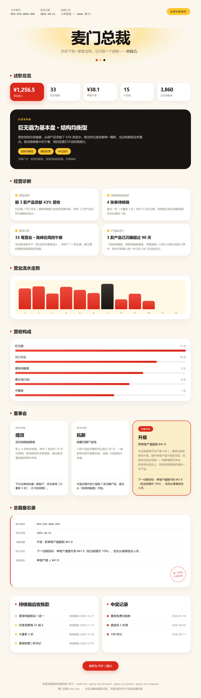

<div align="center">

# 麦门总裁 · mcd-ceo

**你名下有一家麦当劳。它只有一个顾客——你自己。**

[](https://github.com/M-China/mcd-developer-innovation-challenge)
[](https://nodejs.org)
[](.)
[](./LICENSE)

</div>



---

## 这是什么

大多数工具帮你**记账**。这一个让你**经营**。

它通过麦当劳 MCP 读取你的真实账户数据（历史订单、积分、中奖记录、优惠券），把你换到**经营者的位置**——用一份诊断报告审视这家只有你一个顾客的店，然后做出一个决策。

**为什么这件事值得做**：同一份订单数据，能读出两种完全不同的东西。「消费者视角」看到的是账单——我买了什么、花了多少；「经营者视角」看到的是**结构、效率、成本**——哪几款产品撑起了流水、哪些钱其实可以省下来、这家店的节奏是否健康。这个工具做的就是后一件事：换个位置读数据，结论完全不一样。

而且这个工具是**闭环的**：你做出的经营决策会落盘保存，下次运行时自动回访，告诉你上个任期定的目标到底有没有做到。

## 效果预览

不想申请 Token 也能立刻看到完整效果：

```bash
node ceo.mjs --demo
```

`--demo` 使用内置示例数据生成一份完整报告（就是你上面看到的那张），用来判断值不值得花两分钟配置。

## 快速开始

### 1. 申请 MCP Token

前往 [麦当劳 MCP 开放平台](https://open.mcd.cn/mcp)，手机号登录 → 控制台 → 激活。

### 2. 生成你的经营诊断报告

先获取代码（`git clone` 本仓库，或下载 ZIP 解压），进入 `mcd-ceo` 目录。

运行环境只需 Node.js 18 或以上（用到内置 `fetch` 与 `readline/promises`）。**零依赖，无需 `npm install`，无需构建。**

```bash
# 方式一：直接传 Token
node ceo.mjs --token 你的_TOKEN

# 方式二：环境变量（推荐，避免 Token 进入命令历史）
# Windows PowerShell
$env:MCD_MCP_TOKEN="你的_TOKEN"; node ceo.mjs
# macOS / Linux
MCD_MCP_TOKEN=你的_TOKEN node ceo.mjs
```

运行后会先在终端进入「董事会」——列出三张战略卡，你选一张。然后生成 `mcd-ceo-report-<年份>.html`，浏览器打开即可。

> **想跳过交互？** 用 `--strategy efficiency` 直接指定战略，适合脚本或自动化调用。

### 3. 参数一览

| 参数 | 说明 |
| --- | --- |
| `--demo` | 使用内置示例数据（无需 Token） |
| `--token <T>` | 麦当劳 MCP Token（也可用环境变量 `MCD_MCP_TOKEN`） |
| `--strategy <S>` | 直接指定战略：`efficiency` / `explore` / `upgrade`，跳过交互 |
| `--year <YYYY>` | 本任期年份，默认当前年份 |
| `--out <PATH>` | 输出路径，默认 `mcd-ceo-report-<年份>.html` |
| `--help` | 查看帮助 |

## 报告里有什么

**述职总览** —— 营业收入、营业笔数、单笔产值、产品线规模、企业储备金。

**经营诊断**（四项，全部基于真实数据，不做无据推测）

| 指标 | 依据 |
| --- | --- |
| 营收结构 | 前 3 款产品对总营收的贡献度 |
| 待核销应收账款 | 优惠券数量与最近到期时间 |
| 客流分析 | 交易笔数、高峰星期与时段、高频网点、主要渠道 |
| 产品线活力 | 超过 90 天未复购的「沉睡产品」清单 |

**董事会** —— 三张数据驱动的战略卡，覆盖经营的三个方向：

- **提效**（降成本）：优先核销临期券
- **拓新**（提频次）：唤醒沉睡产品线
- **升级**（提单价）：优化点单组合效率

选定后生成**总裁备忘录**（带编号与任期签章），并把目标写入本地 `mcd-ceo-plan.json`。

**上届目标回访** —— 第二次运行时自动出现：对比上个任期定下的指标，给出「达标 / 尚未达标」的结论。**这是它和一次性报告工具最本质的区别。**

## 目标闭环怎么工作

```
第一次运行  →  选定战略 → 写入 mcd-ceo-plan.json
第二次运行  →  读取目标 → 与当前数据对比 → 输出回访结论
第三次运行  →  继续累积历史，形成经营轨迹
```

`mcd-ceo-plan.json` 生成在**运行命令时所在的目录**，是纯本地文件，可随时查看或删除。

## 目标用户

- **麦当劳高频用户**：想知道自己这一年到底花了多少、结构是否健康、哪里可以更省、哪些钱其实可以花得更值。
- **喜欢年度报告的人**：Spotify Wrapped、年度账单的受众——但这次你扮演的不是用户，是老板。
- **开发者**：想找一个真实调用麦当劳 MCP、零依赖、单命令可运行的最小参考实现。

## 它用到了哪些 MCP 能力

| Tool | 经营用途 |
| --- | --- |
| `order-list` | 营业流水：金额、餐品构成、门店、渠道、时间 |
| `query-my-account` | 企业储备金：可用 / 累计 / 即将过期积分 |
| `query-my-prizes` | 中奖记录 |
| `query-my-coupons` | 待核销应收账款：券与到期时间 |

完整的调用流程与字段映射见 [MCP_INTEGRATION.md](./MCP_INTEGRATION.md)。

## 项目结构

```
mcd-ceo/
├── ceo.mjs                 主程序：CLI、数据分析、经营诊断、决策闭环
├── render.mjs              经营诊断报告的 HTML 渲染
├── mcp-client.mjs          零依赖的 MCP Streamable HTTP 客户端
├── demo-data.mjs           --demo 模式使用的示例数据
├── test-parse.mjs          字段归一化单元测试（20 项断言）
├── assets/preview.png      预览图
├── MCP_INTEGRATION.md      MCP 集成说明（Server / Tool / 流程 / 价值）
├── CONTEST_DECLARATION.md  参赛声明
├── mcp-config.example.json 脱敏后的 MCP 配置示例
└── workbuddy.md            WorkBuddy 开发上下文
```

## 隐私说明

- MCP Token **只在本机内存中使用**，不写入任何文件，不上传到任何第三方服务。
- 所有订单数据只在本地完成计算与渲染，**不离开你的电脑**。
- 生成的 HTML 是**完全静态的单文件**，不含外部脚本、字体或追踪代码，可离线打开、放心分享。
- `mcd-ceo-plan.json` 只保存你自己设定的目标数值，不含任何账户凭证。
- `--demo` 使用程序内置示例数据，不涉及真实账户信息。

## 常见问题

**Q：为什么报告里没有订单数据？**
A：不同账户的历史订单可见范围不同。若当年没有记录，程序会自动退化为使用全部历史账目，并在报告顶部给出提示。

**Q：报错 `HTTP 401`？**
A：Token 无效或已过期，请到 [开放平台](https://open.mcd.cn/mcp) 重新获取。

**Q：报错 `HTTP 429`？**
A：触发限流（每 Token 每分钟 600 次）。本项目一次生成只发起 4 次请求，正常使用不会触发。

**Q：终端没有出现「董事会」提问？**
A：非交互式终端（如管道、CI 环境）会自动跳过提问。可用 `--strategy` 显式指定战略。

## License

[MIT](./LICENSE)

---

本项目为**麦当劳程序员创意开发大赛**参赛作品，由参赛者独立开发。
「麦门总裁」为趣味虚拟设定，**非麦当劳官方产品，亦不构成任何加盟或合作关系**。
餐品信息、价格及供应状态以麦当劳官方渠道的实时结果为准。
